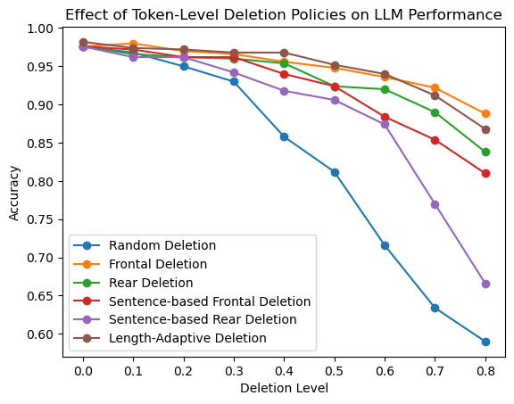

# Positional Token Deletion and LLM Sentiment Classification

How does deleting parts of a text affect an LLM's ability to recover its sentiment, and does *where* the text is deleted matter?

This project degrades IMDb movie reviews with several position-based token deletion policies at increasing severity, then asks GPT-4.1 mini to classify each degraded review as Positive or Negative. The goal is to understand how sentence structure and token position carry sentiment, and to design a deletion policy that preserves it best.

The paper draft is in [`paper/research_draft.pdf`](paper/research_draft.pdf). **Status: work in progress.** The optimal-policy section (RQ3) and the discussion are not finished yet.

## Research questions

- **RQ1:** How does LLM accuracy change as deletion severity increases?
- **RQ2:** Does the method of deletion have significantly different effects on accuracy?
- **RQ3:** Can a deletion policy be designed that preserves the most information and gives consistently higher accuracy than the other methods?

## Deletion policies

All deletion operates on GPT tokens (via `tiktoken`). Severity `n` is the fraction of tokens removed, swept from 0.0 to 0.8 in steps of 0.1.

Every policy is a **priority function**: it gives each token a score, and at severity `n` the `round(n × N)` lowest-scoring tokens of an `N`-token review are deleted. All policies therefore remove the same number of tokens and differ only in *which* tokens go first. See [`policies.py`](policies.py).

| Policy | Priority (lowest deleted first) | Effect |
|---|---|---|
| Random | a random score per token | a random `n` fraction (baseline) |
| Frontal | position in review | the first `n` fraction of the review |
| Rear | −position in review | the last `n` fraction of the review |
| Sentence-based Frontal | position within sentence | the first `n` fraction of **each sentence** |
| Sentence-based Rear | −position within sentence | the last `n` fraction of **each sentence** |
| Length-Adaptive | Rear if ≤180 tokens, else Frontal | heuristic candidate for RQ3 |
| **Learned Priority** | a fitted continuous function w(token) | regression-based candidate for RQ3 |

Sentences are split at `.`, `!` or `?` followed by whitespace, and at `<br />` line breaks. The separator after a sentence counts as the end of that sentence.

## Learning an optimal policy (RQ3)

[`optimize_policy.py`](optimize_policy.py) fits a token-importance function

> w(token) = f(x) + g(s) + z · h(x)

- **x** is the token's position in the review, from 0 to 1.
- **s** is its position within its sentence, from 0 to 1.
- **z** is the standardized log review length.
- **f, g and h** are smooth polynomials (Bernstein basis). The z · h(x) term lets short and long reviews prefer different deletion orders.

The model assumes that a degraded review is classified correctly with probability

> P(correct) = sigmoid(a + b·z + (1/N) · Σ w(kept tokens)).

That expression is linear in the polynomial weights. Fitting w is therefore an L2-regularized logistic regression on features computed from the keep-masks that `run_experiment.py` stores for every classification.

Under this model, removing tokens lowers the predicted accuracy by the sum of their w. So for any budget, the best deletion is the one that **deletes the lowest-w tokens first**, and the fitted w is used directly as the learned policy's priority function.

The polynomial degrees and the regularization strength are chosen by 5-fold cross-validation, grouped by review. The report also compares the model against a position-blind model, which knows only how much was deleted. If the priority model doesn't beat it, the position of the deleted tokens carries no detectable signal.

The learned policy is fitted on the **train** reviews (the original 500). It is then evaluated against every baseline on 500 **holdout** reviews that it never saw, using paired exact McNemar tests at each severity. This is the test of H3.1, and it also gives the first unbiased estimate for Length-Adaptive.

## Results

> **These are the v1 results from the paper draft, produced by the original code.** That code had three known problems:
> - The model ran at its default temperature, so results varied from run to run.
> - Sentences that met at a `<br />` paragraph break were treated as one sentence (this affected 52% of the reviews).
> - The sentence-based policies did not delete the stated fraction: about 5 points too little for SB Frontal and about 2 too much for SB Rear.
>
> The code is now fixed. It is version 3, which also adds the priority system and the holdout split. The v1 data is kept unchanged in [`archive/v1/`](archive/v1/). Rerun the experiment to produce new results (see [Reproducing](#reproducing)).

There are 500 reviews (the same 500 at every policy/severity combination), sampled from the IMDb test split with seed 42. Each cell shows accuracy.

| Severity | Random | Frontal | Rear | SB Frontal | SB Rear | Length-Adaptive* |
|---|---|---|---|---|---|---|
| 0.0 | 0.976 | 0.976 | 0.976 | 0.976 | 0.976 | 0.982 |
| 0.1 | 0.968 | **0.980** | 0.966 | 0.972 | 0.962 | 0.974 |
| 0.2 | 0.950 | 0.970 | 0.962 | 0.962 | 0.962 | **0.972** |
| 0.3 | 0.930 | 0.966 | 0.960 | 0.962 | 0.942 | **0.968** |
| 0.4 | 0.858 | 0.956 | 0.954 | 0.940 | 0.918 | **0.968** |
| 0.5 | 0.812 | 0.948 | 0.924 | 0.924 | 0.906 | **0.952** |
| 0.6 | 0.716 | 0.936 | 0.920 | 0.884 | 0.874 | **0.940** |
| 0.7 | 0.634 | **0.922** | 0.890 | 0.854 | 0.770 | 0.912 |
| 0.8 | 0.590 | **0.888** | 0.838 | 0.810 | 0.666 | 0.868 |

\*Length-Adaptive is an experimental candidate for RQ3. Its 180-token threshold was chosen by exploring these same 500 reviews, so these numbers are in-sample. It still needs to be evaluated on held-out reviews.



Per-severity plots of accuracy against original review length are in [`archive/v1/results/plots/`](archive/v1/results/plots/).

## Repository layout

```
├── policies.py              # tokenization + every deletion policy as a priority function
├── run_experiment.py        # degrade reviews, classify with the LLM, record results
├── optimize_policy.py       # fit the learned priority function; holdout comparison
├── requirements.txt
├── .env.example             # template for your local .env (API key)
├── paper/
│   └── research_draft.pdf   # current paper draft
├── data/                    # created by runs (except dataset_summary.txt)
│   ├── dataset_summary.txt  # IMDb test-set class balance and token-length stats
│   ├── train_records.csv    # every classification on the train reviews
│   └── holdout_records.csv  # every classification on the holdout reviews
├── results/                 # created by runs
│   ├── train/ and holdout/  # results.txt, results.png, plots/ (accuracy vs. review length)
│   ├── learned_policy/      # policy.json, priority_function.png, fit_report.txt
│   └── holdout/comparison.txt   # learned vs. each baseline, with p-values
└── archive/v1/              # original run behind the paper draft's numbers
    ├── run_records.csv      # 27,000 rows
    └── results/
```

Records columns:

| Column | Meaning |
|---|---|
| `index` | row in the IMDb test split |
| `true_label`, `pred_label` | 1 = positive, 0 = negative, −1 = unparsable |
| `correct` | whether the prediction matched |
| `orig_length`, `degraded_length` | length in tokens before and after deletion |
| `kept_mask` | hex-encoded bitmask of which original tokens were kept |
| `level`, `policy`, `policy_label` | severity and policy |
| `version` | experiment version |

## Reproducing

```bash
pip install -r requirements.txt
cp .env.example .env   # then set OPENAI_API_KEY=sk-... in .env (gitignored, never committed)
```

```bash
python run_experiment.py                  # 1. train reviews, baseline policies
python optimize_policy.py fit             # 2. learn the priority function (no API calls)
python run_experiment.py --split holdout  # 3. unseen reviews, baselines + learned policy
python optimize_policy.py evaluate        # 4. paired significance tests (no API calls)
```

- **API calls:** steps 1 and 3 call `gpt-4.1-mini` at temperature 0, up to 27,000 and 31,500 times. Identical inputs are cached, so the actual number is somewhat lower.
- **Interruptions:** both steps save the records CSV after every level/policy block. If a step is interrupted, run the same command again and it continues where it stopped. Once every block is recorded, rerunning only regenerates the tables and plots.
- **Refitting:** each fitted policy is recorded under its own id (`learned_<hash>`). If you refit after step 3, rerun step 3. Only the new policy's blocks call the API.
- **Adding a policy:** write a priority function in `policies.py`, add it to `BASELINE_POLICIES`, and rerun. Only the new blocks call the API.
- **Changing the experiment:** if you change anything that alters the text sent to the model, bump `EXPERIMENT_VERSION` and move the old records aside. The scripts refuse to mix records from different versions.

## Related work

- Maas et al. (2011), *Learning Word Vectors for Sentiment Analysis*: the IMDb dataset
- Jin et al. (2020), *Is BERT Really Robust?* (TextFooler)
- Jiang et al. (2023), *LLMLingua*; Pan et al. (2024), *LLMLingua-2*; Jiang et al. (2024), *LongLLMLingua*
- Herrera et al., prompt-level noise and input-cleaning for LLM inference
